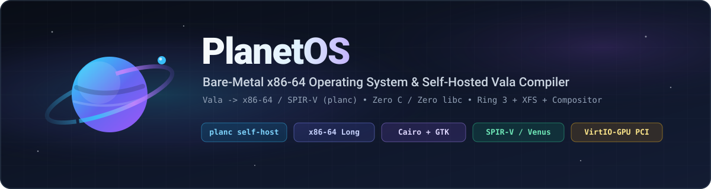

<p align="center">
  
</p>

<p align="center">
  
  
  
  
  
</p>

# PlanetOS

**An operating system and its toolchain, written in [Plan](docs/plan-language.md) (our systems-oriented evolution of Vala, `.plan` / `.vala`), compiled straight to native x86-64 machine code and SPIR-V — with zero C, zero libc, and no external assembler or linker.**

Status: **working self-hosted compiler (`planc`, slices 0–45) + freestanding
x86-64 Long Mode kernel + pure-Vala userland & desktop running in QEMU (0 build warnings).**
`planc` compiles Vala directly to static ELF64 binaries (`--target=host`,
`--target=planetos`, `--freestanding`) and Vulkan SPIR-V shader modules
(`--target=spirv`), with `-O1`/`-O2` optimizations, constant propagation,
unused-variable/overflow checks, DWARF v4 debug info, atomic ARC (`--check-leaks`),
Option B null safety (`--strict-null`), generics, `async`/`yield` M:N coroutines,
`Channel<T>`/`Mutex`, and `[AsmBody]`. The kernel boots in QEMU with Ring 3
per-process `CR3` isolation, per-process framebuffer ownership (`fb_owner_cr3`)
and per-TCB stdio, preemptive `IRQ0` scheduling with non-blocking `wait_nb`/`kill`,
ATA LBA48 + XFS + RAMFS, PS/2 input, double-buffered BGA + VirtIO-GPU PCI, a
modular desktop compositor (`user/compositor/`), the `pcm4` file manager with
`.desktop` manifest support, and pure-Vala `GLib` (`core`, `Math`, `Process`,
`KeyFile`, `MainLoop`, ReDoS-safe `Regex`), `Gee` (`gee-0.8` interfaces and
generic delegates, Robin Hood hashing, Introsort), `Gio` (`File`, `FileInfo`,
`FileEnumerator`, streams, `ListStore`, `SimpleAction`, `AppInfo`, `Application`),
`Cairo`, `Pango`, `libschrift` TrueType, and `GTK` widgets styled with an
elementary OS-inspired Granite light palette.

---

## 1. The three artifacts

| Artifact | What it is | The constraint that defines it |
|---|---|---|
| **`planc`** | Plan/Vala → x86_64 machine code compiler. Own frontend, IR, backend, assembler and linker. Written in Plan/Vala (Stage-0 translatable via `plan2vala`). Second backend target: **SPIR-V** bytecode for Vulkan shaders, from the same IR. | Emits no C. Needs no `cc`, `ld` or `as` to produce binaries, and no glslang/glslc to produce SPIR-V. |
| **`planetrt`** | Runtime and standard library: object model, strings, arrays, `View<T>`, `Simd`, closures, signals, coroutines, errors, allocator. Written in Plan/Vala. | Does not wrap libc. Does not reimplement the GLib ABI. |
| **`planetos`** | Kernel and userland. Written in Plan/Vala, compiled by `planc`, linked with `planetrt`. | No libc, no POSIX, no Linux. |

The difference from the previous revision of this plan is structural: the
compiler used to be `valac` (which emits C) and the runtime used to be a GLib
clone. Now **the compiler is part of the project** and the runtime is just
another Vala library.

### The graphics track (planned)

The toolchain plans a second output target from the same IR: **shaders written
in the Vala dialect, lowered by `planc` to SPIR-V bytecode** for Vulkan — no
GLSL, no glslang, no external shader compiler in the chain. On the `host`
profile, `planetrt` will provide the Vulkan bindings to drive devices and
pipelines from Vala. Whether the target system eventually ships its own Vulkan
ICD is open (decision D-13). Requirements: TC-11, TC-12 and GX-01…GX-05 in
[docs/00-requirements.md](docs/00-requirements.md); backend design in
[docs/02-compiler.md §10.4](docs/02-compiler.md). Nothing of this is
implemented yet; it is specified so that the IR and dialect decisions made
today do not close the door tomorrow.

## 2. Invariants

These six points are not goals: they are boundary conditions. If one of them
breaks, the project stops being what it claims to be.

| ID | Invariant | How it is checked |
|---|---|---|
| **I1** | No C in the target compilation chain | `planc` produces ELF without invoking `cc`/`ld`/`as`; verified in CI by the absence of those executables in the build image |
| **I2** | No binary references libc or POSIX symbols | `nm -u` and `readelf -d` on every ELF in the system: only `planetrt` symbols |
| **I3** | No ABI compatibility with C or GLib is pursued | No signature translation layer; no `extern "C"`; C-interop-only `[CCode]` attributes are rejected |
| **I4** | The compiler is self-hosted | `planc` compiles `planc`; the fixed point is verified (stage N == stage N+1) |
| **I5** | The whole system is Vala, including privileged code | Privileged instruction bodies are `[AsmBody]` inside Vala functions, assembled by `planc` |
| **I6** | The system is not Linux and does not try to be | Own syscall ABI, no `fork`, no `execve`, no Linux process semantics |

## 3. What falls away and what appears

The pivot is not cosmetic. Removing the intermediate C **deletes five hard
problems** and **creates six**:

| Problem that disappears | Why |
|---|---|
| **Generic signal marshalling** | Measured in [E-01](docs/experiments/E01-dialect.md): `valac` already emits a typed marshaller per signal. Static dispatch is not our invention, it is the path Vala takes when it knows the signature |
| **Reflective `GType` in generics** | `valac` stores every type argument in a `gpointer` with a `GType` and two copy/destroy function pointers. Monomorphizing removes that machinery entirely |
| **Struct layout against C** | With no C, layout is our decision: no foreign alignment rules, no delegates split into `(target, destroy_notify)` |
| **The `plibc` layer** | There is no C code demanding `memcpy`, `__stack_chk_fail` or `errno`. The compiler does not emit them |
| **CFI / `.eh_frame`** | Without stack unwinding it is not needed: [E-08](docs/experiments/E08-dwarf.md) measures that GDB debugs fine with a frame pointer |

| Problem that appears | Why it is unavoidable |
|---|---|
| **Own backend** | Instruction selection, register allocation, x86_64 encoding, relocations |
| **Own linker** | Symbol resolution, archive extraction, relocation application, ELF and program headers |
| **Own assembler** | Needed for `[AsmBody]` bodies and for boot |
| **DWARF debugging** | Without it there is no way to debug a kernel written in a language of our own |
| **Bootstrap** | The compiler has to compile itself; the first stage needs an external build path |
| **Own `async` model** | Measured in [E-04](docs/experiments/E04-async.md): Vala's `async` requires GIO (`GTask`). Without GIO the awaitables have to be defined from scratch |

## 4. Specification index

| Document | Contents |
|---|---|
| [docs/00-requirements.md](docs/00-requirements.md) | Normative requirements with ID and verification method. This is the project contract |
| [docs/01-architecture.md](docs/01-architecture.md) | Layers, compilation pipeline, own ABI, memory, concurrency, repository layout |
| [docs/02-compiler.md](docs/02-compiler.md) | **`planc`**: lexer, parser, semantic analysis, IR, backend, ELF, linker, assembler, DWARF, bootstrap |
| [docs/03-runtime-and-stdlib.md](docs/03-runtime-and-stdlib.md) | **`planetrt`**: object model, strings, arrays, closures, signals, coroutines, errors, allocator, standard library |
| [docs/04-kernel.md](docs/04-kernel.md) | Boot, CPU, memory, interrupts, scheduler, syscalls, VFS, drivers |
| [docs/05-userland-and-abi.md](docs/05-userland-and-abi.md) | Syscall ABI, ELF loader, processes, shell, SDK, filesystem layout, packages |
| [docs/06-verification.md](docs/06-verification.md) | Conformance suites, bootstrap fixed point, differential oracle, QEMU harness, validation experiments |
| [docs/07-risks-and-decisions.md](docs/07-risks-and-decisions.md) | Technical risks with signal and mitigation, open decisions with closing criterion |
| [docs/08-io-data-path.md](docs/08-io-data-path.md) | **I/O data path**: per-process handles, grants, `Gio` byte streams and validated descriptor rings; the driver-layer roadmap and its exit criteria |
| [docs/09-gio-planet.md](docs/09-gio-planet.md) | **`Gio.Planet` (`gio-planet-1.0`)**: PlanetOS-native handles, grants, rings, `PlanetIoArena`, `mercury`/`atlas` services, and `Gio` networking/subprocess/converter layers |
| [docs/experiments/](docs/experiments/README.md) | **Measurements made**, with the reproducible harness that produces them |
| [docs/planc/slice-0.md](docs/planc/slice-0.md) | **Implemented slice 0**: what `planc` compiles today, which bytes it emits, what it deliberately does not do |
| [docs/planc/slice-1.md](docs/planc/slice-1.md) | **Implemented slice 1**: variables, stack frame, the calling convention, `if`/`while`, semantic analysis |
| [docs/planc/slice-2.md](docs/planc/slice-2.md) | **Implemented slice 2**: stack arguments, global variables, `.data`/`.bss`, three-segment layout |
| [docs/planc/slice-3.md](docs/planc/slice-3.md) | **Implemented slice 3**: `int`/`string`/`void` type checking, `var`, string ABI layout, `R_X86_64_64` data relocations, `@"..."` formatting |
| [docs/planc/slice-4.md](docs/planc/slice-4.md) | **Implemented slice 4**: 16-byte `string` header ($O(1)$ `.length`), bounds-checked `s[i]` (`--no-bounds-check`), `bool`, `for`/`break`/`continue`, bitwise ops, `enum`, `struct` |
| [docs/planc/slice-5.md](docs/planc/slice-5.md) | **Implemented slice 5**: guarded arena/slab heap allocator, automatic atomic ARC (`--check-leaks`), `T[]`, `s1 + s2`, value `@"..."` templates |
| [docs/planc/slice-6.md](docs/planc/slice-6.md) | **Implemented slice 6**: `class` objects, `.rodata` vtables, `virtual`/`override`/`abstract`, `: base(...)`, destructors, `is`/`as`/casts, Option B `T` vs `T?` null safety (`--no-null-check`) |
| [docs/planc/slice-7.md](docs/planc/slice-7.md) | **Implemented slice 7**: `foreach`, `switch` (VL-14), `s[start:end]` slicing, `?:`/`??` (`T? ?? T -> T`), `const`, `static`/`enum`/`struct` methods, `0x`/`0b`/char literals, integer aliases |
| [docs/planc/slice-8.md](docs/planc/slice-8.md) | **Implemented slice 8**: `errordomain`/`throws`/`try`/`catch`/`finally` (`(rax, rdx)` ABI), `out`/`ref` parameters, inline and `virtual` properties, object initializers, `namespace`/`using`, forward types, multi-file compilation |
| [docs/planc/slice-11.md](docs/planc/slice-11.md) | **Implemented slice 11**: IEEE-754 `float` & `double` on x86-64-v3 (`xmm0`–`xmm7` ABI, pure-integer literal parser, `__planc_double_to_str`/`__planc_str_to_double`) |
| [docs/planc/slice-12.md](docs/planc/slice-12.md) | **Implemented slice 12**: `[AsmBody("...")]` and built-in x86-64 assembler (`TC-04`, `VL-09`, `I5`) |
| [docs/planc/slice-13.md](docs/planc/slice-13.md) | **Implemented slice 13**: `async`/`yield`/`.begin()` heap state machines (`VL-08`), thread-safe allocator, `Async.run()` & `Async.run_parallel(n)` M:N scheduler |
| [docs/planc/slice-14.md](docs/planc/slice-14.md) | **Implemented slice 14**: `signal`, `.connect()`, `.disconnect()`, default handlers, and ARC destructor cleanup |
| [docs/planc/slice-15.md](docs/planc/slice-15.md) | **Implemented slice 15**: `Channel<T>` (`send` / `yield recv` / `close`) and `Mutex` over the M:N `async` scheduler |
| [docs/planc/slice-16.md](docs/planc/slice-16.md) | **Implemented slice 16**: DWARF v4 debug info (`.debug_line`, `.debug_abbrev`, `.debug_info`) for `gdb` and self-hosted `plandbg` |
| [docs/planc/slice-17.md](docs/planc/slice-17.md) | **Implemented slice 17**: `--freestanding` mode, `planetrt` (Multiboot1 + COM1 serial + static `.bss` heap), and `kernel/main.vala` booting x86-64 Long Mode in QEMU |
| [docs/planc/slice-18.md](docs/planc/slice-18.md) | **Implemented slice 18**: kernel 64-bit IDT, PIC 8259, PIT 100 Hz `IRQ0` timer, and in-kernel `async` + `Channel<T>` over hardware interrupts |
| [docs/planc/slice-19.md](docs/planc/slice-19.md) | **Implemented slice 19**: kernel 4 KiB bitmap PMM (`Pmm`) and `int 0x80` (`DPL=3`) syscall dispatcher (`Syscalls`) |
| [docs/planc/slice-20.md](docs/planc/slice-20.md) | **Implemented slice 20**: kernel PS/2 keyboard (`IRQ1`) and primary ATA PIO LBA28 disk drivers verified in QEMU |
| [docs/planc/slice-21.md](docs/planc/slice-21.md) | **Implemented slice 21**: read-only XFS filesystem driver over ATA PIO and expanded `int 0x80` runtime syscalls (`open`/`read`/`close`/`file_size`/`yield`/`exit`) |
| [docs/planc/slice-22.md](docs/planc/slice-22.md) | **Implemented slice 22**: `--target=planetos` userland ELF64 target (`0x800000`, `int 0x80` runtime) and kernel ELF64 loader running `user/init.elf` from XFS in QEMU |
| [docs/planc/slice-23.md](docs/planc/slice-23.md) | **Implemented slice 23**: VGA `80x25` + COM1 RX drivers, `SYS_READDIR` / `SYS_EXEC`, `--image-base`, and interactive `user/shell.vala` (`help`, `ls`, `cat`, `exec`, `ticks`, `mem`, `exit`) |
| [docs/planc/slice-24.md](docs/planc/slice-24.md) | **Implemented slice 24**: native UTF-8 in `planc` (`unichar`, `\u`/`\U`, `char_count`, `get_char`, `validate`) and PlanetOS (VGA UTF-8→CP437, shell backspace), plus writable PMM-backed RAMFS (`SYS_CREATE`, `SYS_WRITE`) |
| [docs/planc/slice-25.md](docs/planc/slice-25.md) | **Implemented slice 25**: `host_planetos.vala`, multi-page `SYS_ALLOC_PAGE`, `argc`/`argv` in `SYS_EXEC`, and `planc.elf` compiling & running tests inside PlanetOS/QEMU |
| [docs/planc/slice-26.md](docs/planc/slice-26.md) | **Implemented slice 26**: preemptive `IRQ0` round-robin scheduler (`kernel/sched.vala`), `SYS_SPAWN`/`SYS_WAIT`/`SYS_PS`, `ps`, `wait`, and `exec ... &` |
| [docs/planc/slice-27.md](docs/planc/slice-27.md) | **Implemented slice 27**: `string.index_of`/`contains` and pure-Vala `GLib`/`Gee` compatibility layer ([stdlib/glib_compat.vala](stdlib/glib_compat.vala), `user/wc.vala`) with zero C or `.vapi` |
| [docs/planc/slice-28.md](docs/planc/slice-28.md) | **Implemented slice 28**: 100% pure-Vala `dash`-inspired shell ([user/shell.vala](user/shell.vala)) with `$VAR`, quotes, `|`, `>`, `>>`, `<`, `&&`, `||`, `if`/`for`, `.sh` scripts, and `SYS_SET_STDIO` |
| [docs/planc/slice-29.md](docs/planc/slice-29.md) | **Implemented slice 29**: SSE enable, Bochs VBE `800x600x32` framebuffer (`kernel/fb.vala`), PS/2 mouse (`IRQ12`), and pure-Vala `Cairo` + `Gdk` layer ([stdlib/cairo_compat.vala](stdlib/cairo_compat.vala) + [stdlib/gdk_compat.vala](stdlib/gdk_compat.vala), `user/cairo_demo.vala`) |
| [docs/planc/slice-30.md](docs/planc/slice-30.md) | **Implemented slice 30**: double-buffered `BGA` display driver (`16 MiB` VRAM, `SYS_FB_INFO`/`SYS_FB_BLIT_RECT`) and `--target=spirv` deterministic Vala shader compiler ([planc/src/spirv.vala](planc/src/spirv.vala)) |
| [docs/planc/slice-31.md](docs/planc/slice-31.md) | **Implemented slice 31**: pure-Vala `Gio` layer in userland ([stdlib/gio_compat.vala](stdlib/gio_compat.vala), [user/gio_demo.vala](user/gio_demo.vala)) with streaming XFS reads and non-truncating append |
| [docs/planc/slice-32.md](docs/planc/slice-32.md) | **Implemented slice 32**: Windows-style shell command resolution ([user/shell.vala](user/shell.vala)) — `gio_demo`, `GIO_DEMO.ELF`, `.\gio_demo` all run `gio_demo.elf`, with `.elf` implied and case-insensitive matching |
| [docs/planc/slice-33.md](docs/planc/slice-33.md) | **Implemented slice 33**: file management — `SYS_UNLINK` (28) and `SYS_RENAME` (29) on RAMFS, `File.delete`/`File.move` in Gio, and `rm`, `cp`, `mv`, `touch`, `ls -l` in the shell |
| [docs/planc/slice-34.md](docs/planc/slice-34.md) | **Implemented slice 34**: directories — kernel path resolution ([kernel/vfs.vala](kernel/vfs.vala)), RAMFS directory entries, `SYS_MKDIR`/`SYS_READDIR(path)`/`SYS_STAT`, `mkdir`/`cd`/`ls [dir]` and Gio `make_directory`/per-directory enumeration |
| [docs/planc/slice-35.md](docs/planc/slice-35.md) | **Implemented slice 35**: asm audit — 35 duplicated `int 0x80` trampolines replaced by [stdlib/planet_sys.vala](stdlib/planet_sys.vala) (3 primitives + typed wrappers), shell without raw memory, and kernel validation of every syscall pointer (`sysguard:ok=1`) |
| [docs/planc/slice-36.md](docs/planc/slice-36.md) | **Implemented slice 36**: Cairo/Gdk split ([stdlib/cairo_compat.vala](stdlib/cairo_compat.vala), [stdlib/gdk_compat.vala](stdlib/gdk_compat.vala)), [GObject](stdlib/gobject_compat.vala) `Type`/`Value` layer and [GModule](stdlib/gmodule_compat.vala) with a static module registry |
| [docs/planc/slice-37.md](docs/planc/slice-37.md) | **Implemented slice 37**: GLib main loop — `MainContext`, `idle_add`/`timeout_add`/`source_remove`, `MainLoop`, and a `Gio.Application.run()` that drives it while `hold()` is active |
| [docs/planc/slice-38.md](docs/planc/slice-38.md) | **Implemented slice 38**: compositor — Openbox-style window model and Gala-style visuals in 100% Vala ([user/compositor.vala](user/compositor.vala)), SPIR-V accent through the shared [Spv.Module](stdlib/spirv_compat.vala), Vulkan backend seam, and the 1024-page framebuffer limit fix |
| [docs/planc/slice-39.md](docs/planc/slice-39.md) | **Implemented slice 39**: Pango/PangoCairo text layout ([stdlib/pango_compat.vala](stdlib/pango_compat.vala)), damage tracking with rect blits in the compositor, keyboard modifiers (`SYS_KEY_MODS`) with Alt+Tab and Super+arrows tiling, and a per-pixel SPIR-V shader using `gl_FragCoord` ([user/frag_pattern.vala](user/frag_pattern.vala)) |
| [docs/planc/slice-40.md](docs/planc/slice-40.md) | **Implemented slice 40**: SPIR-V push constants (`uniform_time/width/height`) with an animated background (`--animate`), damage-rect merging and occlusion culling in the compositor, and Pango colour attribute runs |
| [docs/planc/slice-41.md](docs/planc/slice-41.md) | **Implemented slice 41**: C -> Vala feasibility probe ([tools/c_coverage.py](tools/c_coverage.py)) — preprocesses with a fake libc, classifies tier-0/1/2 constructs and reports clean functions plus the libc shim list; 95.4% of 329 library functions have no structural blocker, kernel drivers do not parse without their headers |
| [docs/planc/slice-42.md](docs/planc/slice-42.md) | **Implemented slice 42**: C -> Vala translator for the tier-0/1 subset ([tools/c2vala.py](tools/c2vala.py)) with a differential harness against gcc ([tools/c2vala_tests/run.py](tools/c2vala_tests/run.py)); `jsmn` translates and prints identical tokens |
| [docs/planc/slice-43.md](docs/planc/slice-43.md) | **Implemented slice 43**: a memory model for the C -> Vala translator (`malloc`/`calloc` -> GC-owned Vala arrays, `free` -> documented no-op, `realloc`/pointer arithmetic/allocated aggregates still refused) and `--report`, which translates what is in scope, stubs the rest and prints a per-function verdict (exit 3 on partial) |
| [docs/planc/slice-46-c2vala-on-windows.md](docs/planc/slice-46-c2vala-on-windows.md) | **Implemented slice 46**: the native Vala C -> Vala translator now builds for the **host** with valac ([tools/c2vala/build_host.sh](tools/c2vala/build_host.sh), GLib `Host`/`StrBuilder` in [tools/c2vala/host_glib.vala](tools/c2vala/host_glib.vala)) so it runs on Windows, plus four strict-Vala emission fixes (declarations, assignments, `char *` buffer elements, call arguments) that valac rejected but planc tolerated |
| [docs/planc/slice-47-surface-reuse.md](docs/planc/slice-47-surface-reuse.md) | **Implemented slice 47**: the compositor self-test shares one framebuffer instead of allocating five 1280x720 surfaces (900 contiguous frames each), which is what made `graphics --animate` fail with `FAIL damage-surface-alloc` and then fault through a null buffer; QEMU is back to 14/14 |
| [docs/planc/slice-44.md](docs/planc/slice-44.md) | **Implemented slice 44**: pure-Vala `libschrift` TrueType rasterizer ([stdlib/schrift.vala](stdlib/schrift.vala)), modular `Gtk` layer ([stdlib/gtk/](stdlib/gtk/window.vala)) with glyph cache & `Kind.GTK` inside [user/compositor.vala](user/compositor.vala), `Cairo` rounded rects/gradients/alpha masks, `Ata` LBA48/multi-sector/cache-flush ([kernel/ata.vala](kernel/ata.vala)), and `-O2` builds in `run-qemu` |
| [docs/planc/slice-45-vulkan-venus.md](docs/planc/slice-45-vulkan-venus.md) | **Implemented slice 45 (Phase 1)**: VirtIO-GPU Modern PCI driver ([kernel/virtio_gpu.vala](kernel/virtio_gpu.vala)) with MMIO BAR mapping, `controlq`, `GET_DISPLAY_INFO`, `CAPSET_VENUS` detection, and roadmap for Vulkan over Venus + `planc --target=spirv` |
| [docs/planc/slice-48-virtio-gpu-phase3.md](docs/planc/slice-48-virtio-gpu-phase3.md) | **Implemented slice 48 (Phase 3)**: fixes the `RESOURCE_CREATE_BLOB` wire order (`blob_id` before `size`) and the Venus capset check (`max_size > 0`); adds `CTX_DETACH_RESOURCE`, `RESOURCE_UNREF`, per-task context/blob ownership and release on reap, a checked blob mapping with unwind, `SYS_GPU_BLOB_DESTROY`, and the `gpu` / `gpu probe` instrument that verifies context create, `SUBMIT_3D` and cleanup under `virtio-gpu-gl-pci` |
| [docs/planc/slice-49-gpu-res3d-and-svg-cursor.md](docs/planc/slice-49-gpu-res3d-and-svg-cursor.md) | **Implemented slice 49**: classic VirGL 3D resources (`RESOURCE_CREATE_3D` + attach, `SYS_GPU_3D_CREATE`, `resource_destroy` for blobs and 3D), the PMM zero/poison-under-kernel-CR3 fix that the probe exposed, and the real `cursor.svg` in the compositor via `Gsk.Path` (SVG path parser), Cairo polygon fill/`draw_rgba`, and the same BGRA image for the software and VirtIO-GPU cursors |
| [docs/planc/slice-53-kernel-threads.md](docs/planc/slice-53-kernel-threads.md) | **Implemented slice 53**: `GLib.Thread` lowers to `SYS_THREAD_SPAWN`/`SYS_WAIT` on `--target=planetos` and ends its task with `SYS_EXIT`; the thread-stack lifecycle fixes that the first real reap exposed (`spawn_thread` name write after mapping, `map_supervisor_range` around `Pmm.free_frame`) |
| [docs/planc/slice-54-calendar-and-uri.md](docs/planc/slice-54-calendar-and-uri.md) | **Implemented slice 54**: `GLib.TimeZone`/`Date`/`Uri`/`BookmarkFile`/`MarkupParseContext`/`OptionGroup`/`Hmac`/`Datalist` ([stdlib/glib/](stdlib/glib/time.vala)); the compositor gains a date+zone top bar, a `calendar` window (`[`/`]`/`t`) and a signed `places` window, and `wc --help` prints option groups |
| [docs/planc/slice-55-arrays-nullcond-visibility.md](docs/planc/slice-55-arrays-nullcond-visibility.md) | **Implemented slice 55**: `in` operator, `resize()`/`move()`, safe 2-dimensional arrays, null-conditional `?.`, and opt-in compile-time visibility |
| [docs/planc/slice-56-operators.md](docs/planc/slice-56-operators.md) | **Implemented slice 56**: bounded expression recursion (no more compiler stack overflow at ~64 chained operators; recursive frames 32 KB -> 200 B), `idiv`-free `/` and `%` (power-of-two shifts, and Granlund-Montgomery reciprocals for other constants), `lea` for `*2/*3/*5/*9` and `reg+reg`, character-based operator dispatch, and `double`/`float` locals kept in xmm0 instead of round-tripping through rax (16% on FP-local code) |
| [docs/planc/memory-safety.md](docs/planc/memory-safety.md) | **Memory safety layer**: refcount ABI with poison/`dying` states, `--debug-memory` UAF detection, `--strict-ownership` borrow rules (`unowned`, escapes, `ref`/`out`), `[AsmBody]` confined to trusted code, and the `Arena`/SIMD extensions |
| [docs/planc/dialect.md](docs/planc/dialect.md) | **Dialect reference**: the slot-based ABI, everything the dialect accepts (with the test that proves it), the deliberate divergences from Vala (`&local` rejected, asm confinement, `Object` as universal root), the CLI flags, the runtime panics and the known gaps |
| — | **Recent enhancements**: x86-64-v3 SIMD (`AVX2`/`FMA3`/`SSE4.1`) in `mathlib.dlib`, `Cairo`, `Fb`, and `Gsk.Path`; modular `stdlib/gdk/` and `stdlib/gsk/`; PS/2 IntelliMouse scroll wheel (`kernel/mouse.vala` → `Gdk.EventType.SCROLL` → `Gtk`/`Compositor`); draggable `ScrolledWindow`, `Switch`, `Scale`, and `Frame` widgets; dedicated `vte_sh.elf` (`0xB00000`) for compositor VTE; native editors `pluto.elf` (nano-style TUI) and `saturn.elf` (Geany-style GTK IDE) |
| — | **Stdlib & Compiler hardening**: generic delegates (`CompareDataFunc<G>`, `MapFunc<R, G>`, etc.) and transitive generic inheritance/monomorphization with anti-DoS cap (`MAX_GENERIC_INSTANTIATIONS`) in `planc`; modular `stdlib/glib/` (`Math`, `Process`, memoized ReDoS-safe `Regex`), `stdlib/gee/` (`gee-0.8` `Iterator`/`Iterable`/`Collection`/`List`/`Set`/`Queue`/`Deque`, Robin Hood hashing + backward-shift deletion, Introsort), and `stdlib/gio/` (`OutputStream.write_string`, bitmask flags, `File.replace` backup, `ListStore.splice`); safe `GLib.Process` argument quoting/splitting integrated into `saturn.elf`, `pcm4.elf`, and `Gio.AppInfo` |

## 5. Ports

| Port | What it shows |
| --- | --- |
| [ports/doom](ports/doom/README.md) | `doomgeneric` translated with `c2vala` and built with `planc`: WAD from XFS, software renderer, virtio-gpu present. `ports/doom/build.ps1` then `run-qemu.ps1 -Add/-Run` |

## 6. State of the measurements

The specification distinguishes **decisions** (we make them) from
**assumptions** (they must be measured). Seven assumptions are already answered
with reproducible measurement:

| Assumption | Measured result | Evidence |
|---|---|---|
| Constructs Vala accepts | 39 cases, 29 compile; the rejections are language rules | [E-01](docs/experiments/E01-dialect.md) |
| Generics | `valac` erases the type and boxes with `GType`; we monomorphize | [E-01 §3](docs/experiments/E01-dialect.md) |
| Delegates | `valac` uses `fn` + a `(target, destroy_notify)` pair; we use a fat pointer | [E-01 §4](docs/experiments/E01-dialect.md) |
| Construction order | defaults → `construct` properties → `construct` block → body | [E-01 §5](docs/experiments/E01-dialect.md) |
| `async` | tied to GIO; the shape is reusable, not the API | [E-04](docs/experiments/E04-async.md) |
| `[CCode]` attributes | `cheader_filename` ×752 forces rejection at the point of use | [E-06](docs/experiments/E06-vapis.md) |
| DWARF without CFI | GDB debugs with a frame pointer and no `.eh_frame` | [E-08](docs/experiments/E08-dwarf.md) |

Reproducible without root:

```sh
experiments/oracle/install.sh
. experiments/oracle/env.sh
experiments/e01-dialect/run.sh
```

`valac` is used **only as a development oracle**. It appears in no artifact of
the system.

### What the toolchain does today

```sh
./planc/build.sh                     # needs the Vala oracle (Linux)
./tools/build-planc-host.sh          # or: rebuild with the MSYS2 UCRT64 valac
printf 'int fact(int n) {\n    if (n <= 1) { return 1; }\n    return n * fact(n - 1);\n}\nint main() {\n    var r = fact(5);\n    print(@"fact(5)=$r\n");\n    return r;\n}\n' > /tmp/fact.vala
./planc/build/planc /tmp/fact.vala -o /tmp/fact
/tmp/fact; echo $?     # prints fact(5)=120 and exits 120 under the project ABI
./planc/tests/run.sh   # full compiler & runtime test suite (226/228 cases passing)
./planc/bootstrap.sh   # self-hosted fixed point: sha256(planc2) == sha256(planc3)
```

The accepted subset now covers `int`/`int8`–`int64`/`uint8`–`uint64`/`size_t`/
`ssize_t`/`char`/`uchar`/`bool`/`string`/`enum`/`errordomain`/`struct`/`T[]`/
`class`/`interface`/`delegate`/`Error`/`T?`/`void` functions and methods
(`static`, `virtual`, `override`, `abstract`, plus `enum`/`struct` methods) with
value, `out`, and `ref` parameters (any number; beyond the sixth they travel on
the stack) and default parameter values, `const` declarations, local `var` type
inference, 64-bit integer (hex `0x`, binary `0b`, char `'x'`, underscore/suffix
literals), bitwise expressions, and scalar integer casts (`(uint8)`, `(int8)`,
etc.), comparisons, short-circuit logic, ternary `?:`, lazy null-coalescing `??`
(`T? ?? T` -> non-null `T`), guarded arena + size-class heap allocation,
compiler-inserted atomic reference counting (leak-checkable via
`--check-leaks`), compile-time monomorphized generics (`Box<T>`, `Pair<K, V>`,
`struct Span<T>`) plus built-in `GenericArray<T>` (`.add`, `.length`, `[i]`,
`foreach`), single-inheritance `class` hierarchies with `.rodata` vtables and
`interface` `.rodata` `itable` dispatch (VL-01, prerequisite interfaces, default
method bodies, `IFoo[]`), `: base(...)` and `: this(...)` / `: this.named(...)`
constructor chaining with named constructors (`new Cls.named(...)`), inline and
custom/`virtual`/`override` properties (`{ get; set; default = ...; }`), `new
Cls() { prop = expr }` object initializers, `~Destructor()` hierarchical
cleanup, 16-byte `{ #code, #env }` `delegate`s and lambdas/capturing closures
with ARC-managed `#env`, `throws`/`throw`/`try`/`catch`/`finally` checked error
propagation via `(rax, rdx)`, `is`/`as`/checked casts, Option B null safety
(compile-time `T` + flow narrowing + `--no-null-check` opt-out on unnarrowed
`T?`), dynamic arrays (`new T[n]`, array literals, `.length`, bounds-checked
`arr[i]` reads/writes, retained `foreach`), `main(string[] args)` startup build,
`string` literals/variables/globals with 16-byte ABI headers, concatenation
(`s1 + s2`), bounds-checked slicing (`s[start:end]`), value-producing `@"..."`
templates, $O(1)$ `.length`, bounds-checked `s[i]` (`--no-bounds-check`),
`==`/`!=` string and reference comparisons, `if`/`else`, `switch`/`case`/
`default` (VL-14), `while`, `for`/`break`/`continue`, `+=`/`-=`/`++`/`--`,
value-semantics `struct`s, `owned`/`unowned` syntax hints, `namespace`/`using`
blocks, cross-file forward types, multi-file CLI inputs, global variables with
`.data`/`.bss` (`R_X86_64_64` relocations for string globals), and `print` /
`exit` builtins.
The calling convention is the project ABI (§3.1 of [01-architecture.md](docs/01-architecture.md)):
arguments in `rdi`–`r9` plus stack, return in `rax` (plus `Error*` in `rdx`
for `throws` functions), `rbp` frame pointer, 16-byte stack alignment at every
call, no red zone.

Produced binaries have three `PT_LOAD` segments (R|X, R and RW — never RWX,
and never one page mapped with two permission sets), an empty `nm -u`, a
`.symtab` that makes `objdump -d` and `gdb` work, and byte-identical output
across runs. The compiler is self-hosted: `planc/bootstrap.sh` compiles the
compiler with itself to a byte-identical fixed point and runs the full suite
under the result. See [docs/planc/slice-9.md](docs/planc/slice-9.md) and
[docs/planc/slice-10.md](docs/planc/slice-10.md).

### Running PlanetOS in QEMU

Both launchers build the kernel, the userland and `planc.elf` with `planc`,
generate the XFS boot image with [tools/mkdisk.py](tools/mkdisk.py) and start
QEMU. A window opens by default; the serial console goes to a log file so the
terminal stays free.

```sh
# Linux / macOS / MSYS2
./run-qemu.sh              # QEMU window
./run-qemu.sh --headless   # serial-only, the shell uses this terminal
```

```powershell
# Windows PowerShell (finds MSYS2 UCRT64 automatically)
.\run-qemu.ps1             # QEMU window
.\run-qemu.ps1 -Headless   # serial-only
.\run-qemu.ps1 -NoBuild    # reuse the artifacts from the last build

# Window plus a shell this terminal can type into (the framebuffer stays
# visible, the keyboard goes to the guest): type the program at the prompt.
.\run-qemu.ps1 -Sdl -Serial -NoBuild
#   🪐 : doom.elf -iwad /freedoom1.wad

# Put a program (and its data) in the image and run it headless:
.\run-qemu.ps1 -Headless -Add .\build\doom.elf,.\build\freedoom1.wad `
        -Run 'doom.elf -iwad /freedoom1.wad' -RunSeconds 60
```

`-Add` (bash: `--add=FILE`) drops extra files in the image root and `-Run`
(bash: `--run=CMD`, `--run-seconds=N`) types a command at the guest shell, so a
port can be exercised end to end without rebuilding the launcher. The same
switches are what the DOOM port uses to run on the stock image.

By default a windowed run writes the guest serial console to `<out>\serial.log`,
so the shell cannot be typed into. `-Serial` sends it to the terminal instead,
which is what lets a program be started by hand while its output is on screen;
it also accepts `-Run` when the window should stay up.

If the execution policy blocks the script:

```powershell
powershell -NoProfile -ExecutionPolicy Bypass -File .\run-qemu.ps1
```

Both launchers boot on virtio-gpu with virgl by default
(`-device virtio-gpu-gl-pci`, `-display gtk,gl=on` / `sdl,gl=on`), so the guest
banner reports `VirtIO-GPU 3D/VirGL` and the compositor draws through the host
GL driver. The GPU modes are:

| PowerShell | bash | QEMU device |
| --- | --- | --- |
| — (default) | — (default) | `virtio-gpu-gl-pci` (virgl) |
| `-Vga` | `--vga` | `-vga std` (plain VGA/BGA path) |
| `-Virtio` | `--virtio` | `virtio-gpu-pci` (2D, no GL) |
| `-Venus` / `-VirtioGl` | `--venus` / `--virtio-gl` | `virtio-gpu-gl-pci,venus=on,blob=on,hostmem=256M` |
| `-Sdl` | `--sdl` | same device, SDL window instead of GTK |

A relative pointing device (PS/2) only receives motion while QEMU has captured
the host pointer, so the window backend matters: use `-Sdl` if the pointer does
not follow the mouse under GTK. The compositor reports what it actually saw when
it exits, which separates "no events reached the guest" from "events arrived but
the screen did not change":

```
compositor: frames=104 moves=37 windows=4 dirty=10 flush_ms=31 blit_ms=10
                      ^^^^^^^^ zero means no pointer events arrived
```

Venus needs a `virglrenderer` built with the render server; the MSYS2 one is
not, so `-Venus` there falls back to a plain virgl context. Headless mode always
uses the non-GL `virtio-gpu-pci`, because QEMU has no OpenGL backend without a
window (`egl-headless` boots but fails its scanouts on Windows).

### Debugging the guest without adding prints

The kernel keeps a categorised log ring (`kernel/klog.vala`) and the shell can
drive it, so a fault can be reproduced first and inspected afterwards:

```sh
dmesg                 # dump the records (oldest first)
dmesg -c              # dump and clear
log                   # level, per-category switches, record count
log input debug       # turn one category up (boot input gpu mem vfs sched exec)
log level 3           # 0=error 1=warn 2=info 3=debug, all categories
log clear
mouse                 # PS/2 state plus counters: packets/bytes/resync
```

Nothing is recorded above the current level, and `log level 2` (the default)
keeps only warnings and errors plus the boot summaries, so leaving a
`Klog.debug ()` call in a hot path costs nothing until someone asks for it.
Subsystems also keep cheap always-on counters (`mouse` above, `mem`, `ps`)
because "no events arrive" and "events arrive but are dropped" need different
fixes.

Type `exit` in the guest shell (or close the QEMU window) to shut the machine
down. The window-mode serial log is `<msys64>\tmp\planetos-qemu\serial.log`
(`/tmp/planetos-qemu/serial.log` from bash).

### Tests

```sh
python tests/qemu.py             # build once, then run cases in parallel
python tests/qemu.py --no-build  # reuse the last build
python tests/qemu.py --case gio  # a single case
python tests/qemu.py --list      # list the cases
python tests/qemu.py -j 1        # run sequentially
```

Each case is a pair of files in [tests/cases](tests/cases): a `.sh` with the
commands typed into the guest shell and a `.expect` with the assertions
(`text` substring in order, `=text` whole line, `!text` must be absent,
`~regex`). The harness builds through `run-qemu.sh --build-only` /
`run-qemu.ps1 -BuildOnly`, boots headless with `-snapshot` (allowing parallel
workers via `--jobs`/`-j`, auto-detecting KVM on Linux with `--accel auto`,
and using `--delay 0.005` between typed characters), and reports the serial log
when a case fails.

## 7. Changes from the previous revision

| Before | Now |
|---|---|
| `valac` + `gcc` with an own sysroot | `planc`, an own compiler that emits machine code |
| A clone of the GLib ABI (`g_malloc`, `g_object_new`…) | An own Vala standard library, with no inherited names or ABI |
| A `plibc` layer with `memcpy`/`printf`/`malloc` | It does not exist: there is no C demanding it |
| libffi or generated *marshallers* for signals | Static dispatch generated by the compiler |
| Reflective `GType`/`GValue` | Static type descriptors, generated on demand |
| Effort estimates, calendar, time-boxed phases | Requirements, invariants and verification criteria |

---

## 8. Next Milestones & Ambitious Roadmap

| Track | Next Milestones | Target Outcome |
|---|---|---|
| **Compositor & Wayland-lite** | Bidirectional pointer/keyboard event forwarding to `Kind.EXT` windows through a shared input ring (done), zero-copy shared window surfaces with up to four damage rectangles per frame (done, attached with `SYS_MAP_USER_AT` today and with `SYS_GRANT` after Phase A2), dynamic window resize, and Virgl/Vulkan ICD acceleration. | External pure-Vala GUI apps run interactively inside compositor windows with zero copies. |
| **`pcm4` & Desktop Apps** | Port `volume-manager` & `connect-server-dialog`, add multi-tab file browsing, image/code previews, and a built-in graphical terminal + text editor. | Full daily-driver file manager and desktop workflow inside PlanetOS. |
| **I/O data path & IPC** | Phase A of [docs/08](docs/08-io-data-path.md): per-process handles with rights, `SYS_GRANT`, recoverable user copies; then `devfs` + `Gio` streams for byte devices (STREAMS-style filter chains in userland), validated descriptor rings for block/GPU, `virtio-net` + a LibOS TCP/IP stack, and audio. | Cross-process-safe handles, userland pipelines, networking and multimedia without moving physical drivers out of ring 0. |
| **Self-Hosted SDK** | Compile GUI apps (`gtk_demo.elf`, `pcm4.elf`) directly inside PlanetOS using `planc.elf` with pre-indexed modular `stdlib/` packages. | Self-sufficient Vala OS capable of building its own desktop software on-target. |
